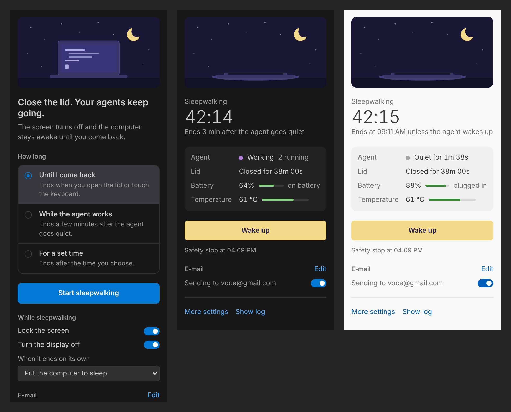

# Sleepwalker

**Close the lid. Your AI agents keep going.**

Sleepwalker is a VS Code extension for people who run long tasks with Claude Code, Codex, Aider and other coding agents. Click one button and the screen turns off, the session locks, and the computer stays awake, even with the lid closed, until you come back. When you open the lid, everything goes back to normal and you get a summary of what happened while you were away.

[Leia em português](README.pt-BR.md)



## What it does

- **Keeps working with the lid closed.** Windows' lid action is set to "do nothing" for the session (and the idle sleep timer is lifted); on Linux, the lid switch is blocked through systemd-logind.
- **Turns the display off and locks the session**, so the machine is safe to leave.
- **Wakes up when you come back**: opening the lid or touching the keyboard ends the session and restores every setting.
- **Three ways to run**
  - *Until I come back*
  - *While the agent works*: ends a few minutes after terminal commands stop and the agent processes go quiet
  - *For a set time*
- **Guards your laptop** when it is in a bag: it puts the computer to sleep when the battery runs low or the temperature gets too high, and never runs longer than a safety limit (8 h by default).
- **E-mails you** when the agent finishes, when time is up, when it stops for safety, or when the battery or temperature get close to the limit.
- **Never leaves your settings changed.** The original values are saved before anything changes, and they are restored even if VS Code crashes: a small helper restores them when VS Code goes away, and Windows itself restores them at the next logon if everything else failed.

## Using it

Open the Sleepwalker panel from the activity bar (the moon icon), pick how long, and press **Start sleepwalking**. You can also click the eye in the status bar or run **Sleepwalker: Start sleepwalking…** from the command palette.

While a session runs, the status bar shows the elapsed time, and the panel shows whether the agent is working, how long the lid has been closed, the battery and the temperature. Press **Wake up** or just open the lid to end it.

### How "the agent is working" is detected

Two signals, either one counts:

1. **Terminal commands** running in VS Code (through shell integration).
2. **CPU used by agent processes** named in `sleepwalker.agent.watchProcesses` (`claude`, `codex`, `aider`, `gemini`, `opencode`, `goose`, `cursor-agent`, `copilot` by default). On Linux, agents started through `node` or `python` are recognized by their script path too.

### E-mail notifications

Open the panel, find **E-mail**, and press **Set up**. Pick Gmail, iCloud or enter any SMTP server.

Gmail and iCloud need an **app password**, not your normal password:

- Gmail: turn on 2-Step Verification, then create one at <https://myaccount.google.com/apppasswords>.
- iCloud: create one at <https://account.apple.com> under *Sign-In and Security → App-Specific Passwords*.

The password is stored in VS Code's secret storage, never in `settings.json`. Use **Send a test** to check the setup.

## Settings

| Setting | Default | What it does |
| --- | --- | --- |
| `sleepwalker.lockScreen` | `true` | Lock the session when a session starts. |
| `sleepwalker.turnOffDisplay` | `true` | Turn the display off when a session starts. |
| `sleepwalker.endAction` | `sleep` | What to do when a session ends on its own: `sleep`, `hibernate` or `none`. When you come back yourself, nothing happens. |
| `sleepwalker.maxHours` | `8` | Safety limit for any session. |
| `sleepwalker.agent.idleMinutes` | `3` | Quiet minutes before *While the agent works* ends. |
| `sleepwalker.agent.watchProcesses` | see above | Process names that count as agents. |
| `sleepwalker.agent.cpuThresholdPercent` | `5` | CPU (% of one core) above which a watched process counts as working. |
| `sleepwalker.guardrails.minBatteryPercent` | `15` | Sleep below this battery level when unplugged. `0` turns it off. |
| `sleepwalker.guardrails.maxTemperatureC` | `90` | Sleep at this temperature. `0` turns it off. |
| `sleepwalker.email.*` | | Set these from the panel. |

## Platform notes

**Windows 10 and 11.** Changes are made with `powercfg` to the active power plan, without administrator rights. If your organization manages power settings through Group Policy, they cannot be changed and Sleepwalker says so. Temperature sensors are usually only readable when VS Code runs as administrator; without them the temperature guard is simply off. You can see Sleepwalker's keep-awake request with `powercfg /requests`.

**Linux.** Needs a systemd-based distribution (`systemd-inhibit`). The lid is read from `/proc/acpi/button/lid`, battery and temperature from `/sys`. Turning the display off works on X11, GNOME and KDE; detecting keyboard input needs `xprintidle` on X11 and works out of the box on GNOME.

**macOS** is not supported yet.

**Remote development.** Sleepwalker always runs on your local machine (it is a UI extension), so it works with Remote SSH, WSL and dev containers. Agent processes running on the remote side are not seen by the CPU detector; terminal commands are.

## Development

```bash
npm install
npm test          # unit tests for the platform-independent logic
npm run build     # bundles to dist/extension.js
npm run package   # typecheck, production build and .vsix
```

Press <kbd>F5</kbd> in VS Code to try it in an Extension Development Host.

Project layout:

- `src/core/`: platform-independent logic (activity detection, guardrails, session record, `powercfg` and `/proc` parsing, e-mail template), fully unit-tested.
- `src/platform/`: the Windows and Linux backends.
- `helpers/windows/sleepwalker-helper.ps1`: the Windows helper (PowerShell with an embedded C# class) that holds the keep-awake request, listens for lid and input events, turns the display off and restores settings if VS Code dies.
- `media/webview/`: the panel.

Before publishing, replace `your-publisher-id` and the repository URLs in `package.json`.

## License

[MIT](LICENSE)
