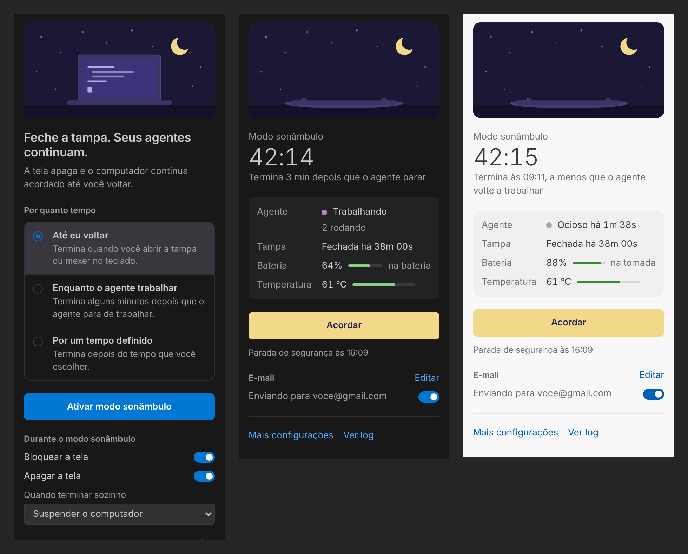

# Sleepwalker

**Feche a tampa. Seus agentes de IA continuam.**

O Sleepwalker é uma extensão do VS Code para quem roda tarefas longas com Claude Code, Codex, Aider e outros agentes. Com um clique, a tela apaga, a sessão é bloqueada e o computador continua acordado, mesmo com a tampa fechada, até você voltar. Quando você abre a tampa, tudo volta ao normal e você recebe um resumo do que aconteceu enquanto estava fora.

[Read in English](README.md)



## O que ele faz

- **Continua trabalhando com a tampa fechada.** No Windows, a ação da tampa vira "não fazer nada" durante a sessão (e o tempo de suspensão por inatividade é suspenso); no Linux, o botão da tampa é bloqueado pelo systemd-logind.
- **Apaga a tela e bloqueia a sessão**, para você poder deixar a máquina sozinha com segurança.
- **Acorda quando você volta**: abrir a tampa ou mexer no teclado encerra a sessão e restaura todas as configurações.
- **Três modos**
  - *Até eu voltar*
  - *Enquanto o agente trabalhar*: termina alguns minutos depois que os comandos no terminal param e os processos do agente ficam ociosos
  - *Por um tempo definido*
- **Protege o notebook** dentro da mochila: suspende o computador se a bateria ficar baixa ou a temperatura subir demais, e nunca passa de um limite de segurança (8 h por padrão).
- **Te avisa por e-mail** quando o agente termina, quando o tempo acaba, quando para por segurança ou quando a bateria ou a temperatura chegam perto do limite.
- **Nunca deixa suas configurações alteradas.** Os valores originais são salvos antes de qualquer mudança e restaurados mesmo se o VS Code travar: um pequeno helper restaura quando o VS Code some, e o próprio Windows restaura no próximo login se todo o resto falhar.

## Como usar

Abra o painel do Sleepwalker pela barra de atividades (o ícone da lua), escolha por quanto tempo e clique em **Ativar modo sonâmbulo**. Também dá para clicar no olho da barra de status ou rodar **Sleepwalker: Ativar modo sonâmbulo…** na paleta de comandos.

Durante a sessão, a barra de status mostra o tempo decorrido, e o painel mostra se o agente está trabalhando, há quanto tempo a tampa está fechada, a bateria e a temperatura. Clique em **Acordar** ou simplesmente abra a tampa para encerrar.

### Como ele sabe que o agente está trabalhando

Dois sinais, qualquer um conta:

1. **Comandos rodando no terminal** do VS Code (via integração de shell).
2. **CPU usada pelos processos de agentes** listados em `sleepwalker.agent.watchProcesses` (`claude`, `codex`, `aider`, `gemini`, `opencode`, `goose`, `cursor-agent`, `copilot` por padrão). No Linux, agentes iniciados via `node` ou `python` também são reconhecidos pelo caminho do script.

### Avisos por e-mail

Abra o painel, procure **E-mail** e clique em **Configurar**. Escolha Gmail, iCloud ou informe qualquer servidor SMTP.

Gmail e iCloud exigem uma **senha de app**, não a sua senha normal:

- Gmail: ative a verificação em duas etapas e crie a senha em <https://myaccount.google.com/apppasswords>.
- iCloud: crie em <https://account.apple.com>, em *Início de sessão e segurança → Senhas específicas de apps*.

A senha fica no armazenamento seguro do VS Code, nunca no `settings.json`. Use **Enviar teste** para conferir.

## Configurações

| Configuração | Padrão | O que faz |
| --- | --- | --- |
| `sleepwalker.lockScreen` | `true` | Bloqueia a sessão ao começar. |
| `sleepwalker.turnOffDisplay` | `true` | Apaga a tela ao começar. |
| `sleepwalker.endAction` | `sleep` | O que fazer quando a sessão termina sozinha: `sleep`, `hibernate` ou `none`. Quando você mesmo volta, nada acontece. |
| `sleepwalker.maxHours` | `8` | Limite de segurança de qualquer sessão. |
| `sleepwalker.agent.idleMinutes` | `3` | Minutos ociosos até o modo *Enquanto o agente trabalhar* terminar. |
| `sleepwalker.agent.watchProcesses` | ver acima | Nomes de processos que contam como agentes. |
| `sleepwalker.agent.cpuThresholdPercent` | `5` | CPU (% de um núcleo) acima da qual um processo conta como trabalhando. |
| `sleepwalker.guardrails.minBatteryPercent` | `15` | Suspende abaixo desse nível de bateria, fora da tomada. `0` desativa. |
| `sleepwalker.guardrails.maxTemperatureC` | `90` | Suspende nessa temperatura. `0` desativa. |
| `sleepwalker.email.*` | | Configure pelo painel. |

## Observações por sistema

**Windows 10 e 11.** As mudanças são feitas com `powercfg` no plano de energia ativo, sem precisar de administrador. Se a sua empresa gerencia as configurações de energia por Política de Grupo, elas não podem ser alteradas e o Sleepwalker avisa. Os sensores de temperatura geralmente só podem ser lidos com o VS Code rodando como administrador; sem eles, a proteção de temperatura fica desligada. O pedido do Sleepwalker para manter o computador acordado aparece em `powercfg /requests`.

**Linux.** Precisa de uma distribuição com systemd (`systemd-inhibit`). A tampa é lida de `/proc/acpi/button/lid`, bateria e temperatura de `/sys`. Apagar a tela funciona no X11, no GNOME e no KDE; detectar o teclado precisa do `xprintidle` no X11 e funciona direto no GNOME.

**macOS** ainda não é suportado.

**Desenvolvimento remoto.** O Sleepwalker sempre roda na sua máquina local (é uma extensão de interface), então funciona com Remote SSH, WSL e dev containers. Processos de agentes rodando no lado remoto não entram na detecção por CPU; comandos de terminal entram.

## Desenvolvimento

```bash
npm install
npm test          # testes da lógica independente de plataforma
npm run build     # gera dist/extension.js
npm run package   # typecheck, build de produção e .vsix
```

Antes de publicar, troque `your-publisher-id` e as URLs do repositório no `package.json`.

## Licença

[MIT](LICENSE)
